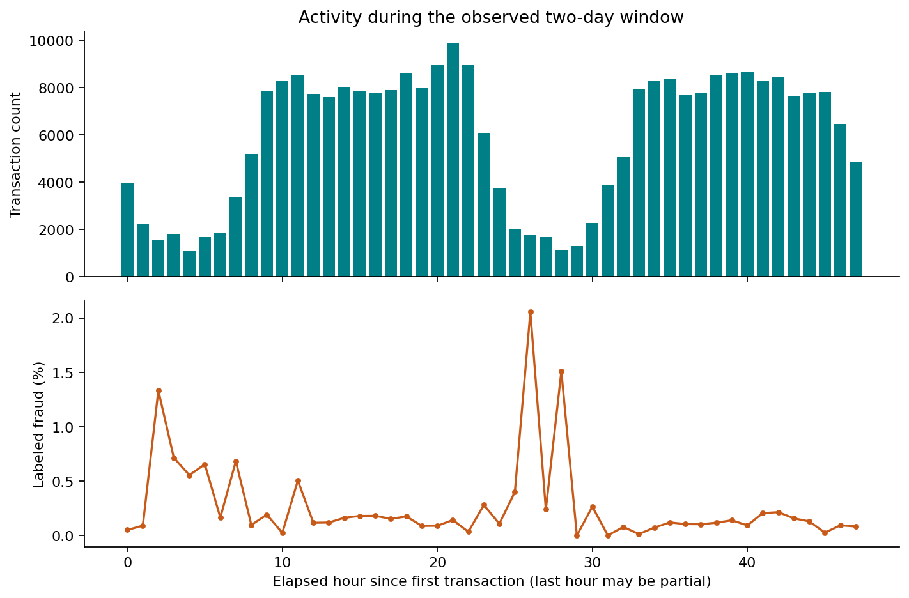

# Credit Card Transaction Analysis

A beginner-friendly SQL and Python portfolio project using **284,807 real credit card transactions** from the ULB/Worldline dataset. Explore amounts, labeled fraud, elapsed-time patterns, and data quality, then explain the findings in plain language.

**Code and original documentation: MIT licensed. External data: separate ODbL/DbCL terms.** The raw dataset is downloaded from the public CSV mirror used by TensorFlow's tutorial; it is not bundled or committed. There is no synthetic dataset or generator.

## Get the project

- **Download it:** [Download ZIP](https://github.com/Krish-Shah-Queens/credit-card-transaction-analysis/archive/refs/heads/main.zip), extract it, and follow the quick start below.
- **Use your browser:** [Open in GitHub Codespaces](https://codespaces.new/Krish-Shah-Queens/credit-card-transaction-analysis). Create the codespace, wait for dependency setup, then run the three Python scripts in its terminal. You can open the notebook in the same browser editor.
- **Read the results first:** [Example findings](reports/example/findings.md) and [executed notebook](notebooks/01_credit_card_analysis.ipynb).

The Codespaces configuration installs the project libraries automatically. To run the analysis there:

```bash
python scripts/download_data.py
python scripts/build_database.py
python scripts/analyze.py
```



## What you will learn

- Load a large CSV into **DuckDB**, a local SQL database that needs no server.
- Use `SELECT`, `GROUP BY`, `CASE`, CTEs, and window functions.
- Check missing values, labels, zero amounts, and exact duplicate rows.
- Use **pandas** for small SQL results and **Matplotlib** for four charts.
- Explain fraud rates, skewed amounts, and precision versus recall.
- Make a reproducible open-source project with tests and GitHub Actions.

The analysis covers all source rows. DuckDB does the large-table work; Python receives aggregated results. This is a descriptive analysis project, not a fraud prediction service.

## Quick start

You need **Python 3.11 or 3.12**, internet access for the first download, and about **1 GB of free disk space**. The pipeline sets DuckDB's query memory budget to 1 GB; the Python process and operating system need additional memory. If Python is not installed, start at [python.org](https://www.python.org/downloads/). On some systems use `python3` or `py` instead of `python`.

Extract this project, open a terminal in its folder, then create an isolated environment:

```bash
python -m venv .venv
```

Activate it on macOS/Linux:

```bash
source .venv/bin/activate
```

Or activate it in Windows PowerShell:

```powershell
.venv\Scripts\Activate.ps1
```

If PowerShell blocks activation, call `.venv\Scripts\python.exe` in place of `python` in the commands below; changing execution policy is unnecessary.

Install the libraries and run the three steps:

```bash
python -m pip install -r requirements.txt
python scripts/download_data.py
python scripts/build_database.py
python scripts/analyze.py
```

The first step downloads approximately 144 MiB and verifies SHA-256. Later runs reuse the verified file. If the download is unavailable, use the [manual Kaggle instructions](docs/DATASET.md#manual-download).

Open `reports/generated/findings.md` for your findings and charts. The folder also contains seven aggregate CSVs and `data_quality.json`. No notebook is needed for this quick start. Rerunning the build replaces the local database after successful validation; analysis regenerates the same output filenames.

## A guided learning route

1. Read the [data dictionary](docs/DATA_DICTIONARY.md) and [dataset notes](docs/DATASET.md).
2. Run the quick start and compare your results with the [checked example report](reports/example/findings.md).
3. Read SQL files `01`–`04`, then run them in the notebook below.
4. Try the [practice questions](docs/EXERCISES.md) before checking the solutions.
5. Study SQL files `05`–`07` to learn window functions and alert-rule tradeoffs.
6. Write three observations and two limitations in your own words.

For an interactive walkthrough:

```bash
python -m pip install -r requirements-dev.txt
python -m notebook notebooks/01_credit_card_analysis.ipynb
```

Choose the Python kernel from your `.venv` if prompted. The notebook reads the database built above and walks through SQL, tables, and charts. SQL uses DuckDB syntax; some functions differ in PostgreSQL, MySQL, or SQLite.

Run a SQL file directly from Python:

```python
from pathlib import Path
import duckdb

with duckdb.connect("data/processed/transactions.duckdb", read_only=True) as con:
    result = con.execute(Path("sql/02_class_summary.sql").read_text()).fetchdf()
print(result)
```

## Questions this project answers

- How many transactions are labeled fraud, and what percentage is that?
- How do mean and median transaction amounts differ across labels?
- How does transaction activity vary across the two-day observation window?
- How do fraud rates differ across amount bands, considering their group sizes?
- How much transaction value is concentrated in the largest-amount decile?
- What happens to precision, recall, and alert volume with an amount-only rule?

There are no merchant names, customer identifiers, locations, or actual timestamps. We cannot analyze customer behavior, spending categories, geography, or monthly trends with this source. `Time` is elapsed seconds, so “elapsed hour 12” is not necessarily noon. Frauds are rare and the data is from 2013; results describe this historical sample.

## Verified reference results

The included example report was generated from the complete external CSV, not a sample. Expect **284,807 rows**, **492 fraud labels**, **0.1727% labeled fraud**, **1,081 exact duplicate extra rows**, and **1,825 zero-amount rows**. Duplicate rows are reported and retained because identical values alone do not prove a repeated transaction. See [findings](reports/example/findings.md) for amounts, charts, and rule metrics.

## Project layout

```text
scripts/                 Download, validate/build, analyze; shared paths
sql/                     Seven commented SQL lessons
notebooks/               Guided SQL + Python walkthrough
docs/                    Source terms, dictionary, exercises, publication guide
tests/                   Offline pipeline and SQL correctness tests
data/raw/                Downloaded CSV (ignored by Git)
data/processed/          Local DuckDB database (ignored by Git)
reports/example/         Checked aggregate results and charts from the full dataset
reports/generated/       Your fresh results (ignored by Git)
.github/workflows/       CI tests on Python 3.11 and 3.12
LICENSE                  MIT license for code and original documentation
```

## Tests and contributions

```bash
python -m pip install -r requirements-dev.txt
python -m pytest -q
```

Tests use tiny hand-authored fixtures and run offline. They check validation failures, duplicate policy, amount-band boundaries, aggregate conservation, window functions, and precision/recall denominators. Full dataset and notebook verification are described in [VALIDATION.md](docs/VALIDATION.md).

First contributions are welcome: improve explanations, add a useful SQL question, or fix a reproducible bug. See [CONTRIBUTING.md](CONTRIBUTING.md).

## Publish your open-source repository

The public source repository is [Krish-Shah-Queens/credit-card-transaction-analysis](https://github.com/Krish-Shah-Queens/credit-card-transaction-analysis). Fork it to make your own version, or follow [PUBLISHING.md](docs/PUBLISHING.md) to publish an independent copy. The code license does not relicense the external data. Keep the raw CSV and database out of Git; retain source attribution with aggregate findings.

## Attribution

Dataset: Worldline and the Machine Learning Group at Université Libre de Bruxelles (ULB). Original listing: [Kaggle Credit Card Fraud Detection](https://www.kaggle.com/datasets/mlg-ulb/creditcardfraud). Download mirror: [TensorFlow's imbalanced-data tutorial](https://www.tensorflow.org/tutorials/structured_data/imbalanced_data). Full citation and dataset terms are in [docs/DATASET.md](docs/DATASET.md).
