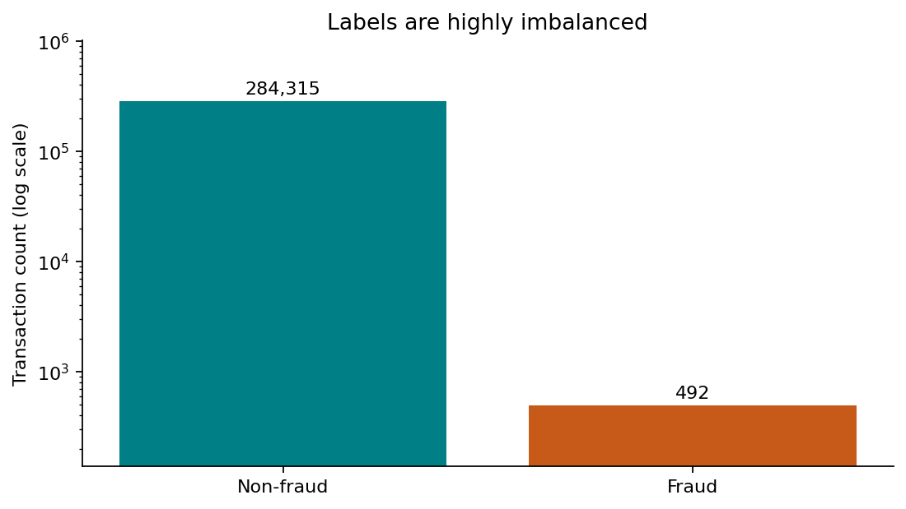
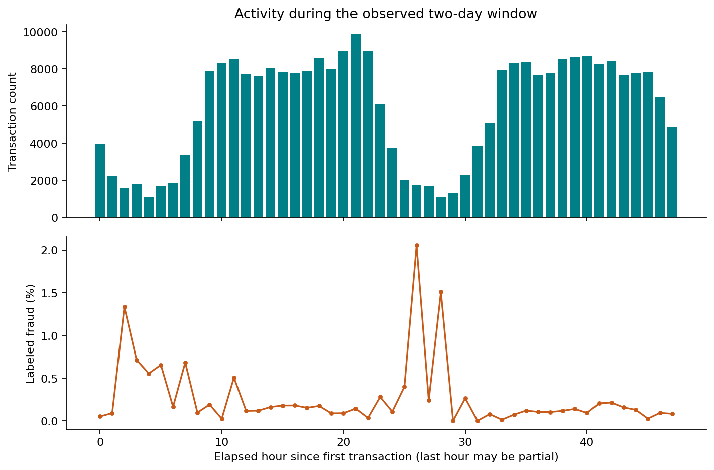
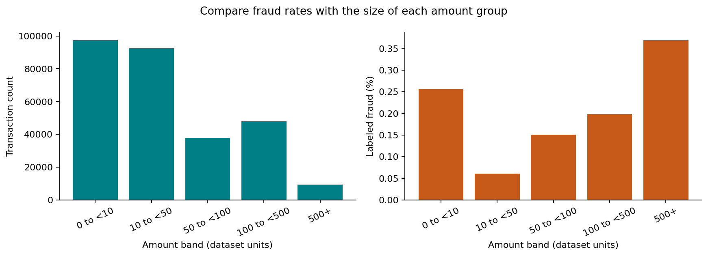
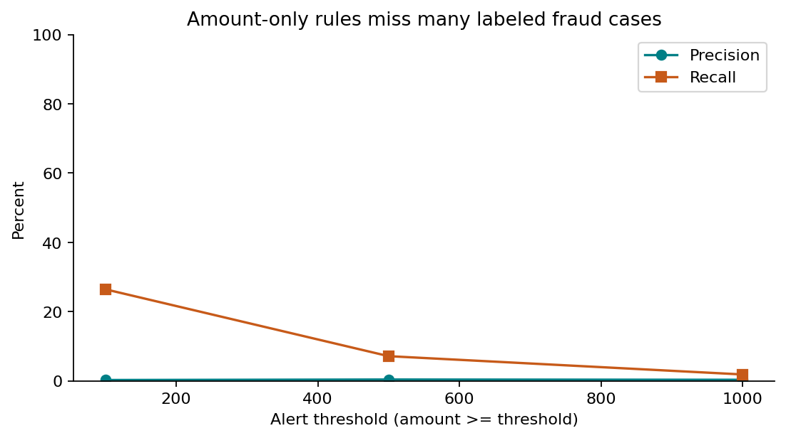

# Credit Card Transaction Analysis — findings

Source: ULB/Worldline 2013 dataset, obtained from TensorFlow's public CSV mirror.
Input SHA-256: `76274b691b16a6c49d3f159c883398e03ccd6d1ee12d9d8ee38f4b4b98551a89`.

- Transactions: **284,807**; labeled fraud: **492** (**0.1727%**).
- Mean amount: **88.35**; median: **22.00**; maximum: **25,691.16** (dataset amount units).
- Total amount: **25,162,590.01**. Amount on fraud-labeled rows: **60,127.97**. This is transaction value, not measured financial loss.
- The largest-amount decile accounts for **62.20%** of total amount. This is a transaction-level measure; customers cannot be identified.
- Exact duplicate extra rows: **1,081**; retained because the source has no unique transaction identifiers.
- Zero-amount rows: **1,825**; retained as valid source observations.
- Missing/non-finite rows: **0**; negative time/amount rows: **0**; invalid-label rows: **0**.

## Simple alert rules

These in-sample descriptions are educational and do not establish predictive performance.

| Threshold | Alerts | Labeled fraud caught | Precision % | Recall % |
| ---: | ---: | ---: | ---: | ---: |
| 100 | 57,385 | 130 | 0.2265 | 26.4228 |
| 500 | 9,492 | 35 | 0.3687 | 7.1138 |
| 1000 | 3,069 | 9 | 0.2933 | 1.8293 |

## Interpretation limits

The observation period is about two days in 2013. Elapsed hour is not local clock time. These results do not support monthly trends, seasonal patterns, merchant comparisons, customer segmentation, or conclusions about today's card transactions. V1–V28 are anonymized PCA components, not identifiable customer attributes. Labels describe the source observations; an association does not establish a cause.

Code and original documentation: MIT. External dataset: separate source terms; see ../../docs/DATASET.md. Raw data is not included in this repository.
